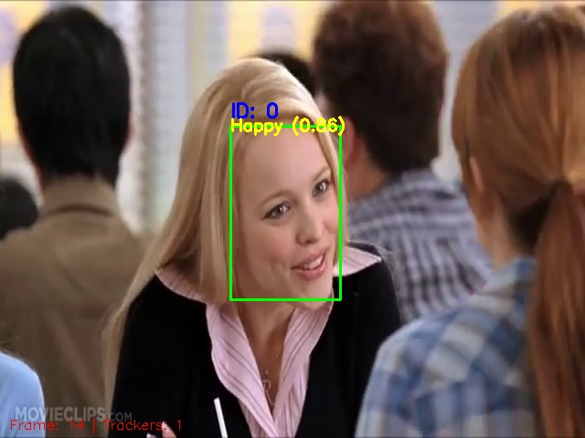

# Emotion Analysis from Video

Detect each face's emotion from a video/webcam, save the emotional and temporal information to analyze. Seven emotion is: Angry, Disgust, Fear, Happy, Neutral, Sad, Surprise.

---

### 1. Install:
- Visual Studio: https://visualstudio.microsoft.com/
- OpenCV: https://opencv.org/releases/

---

### 2. Config OpenCV in Visual Studio:
https://learnopencv.com/code-opencv-in-visual-studio/

---

### 3. Add code to the project:
- Clone the repository
- Copy code in "main.cpp" to project, which is created in step 2
- Copy onnx model files to project.

---

### 4. Build and run project:
The result will be:
- Shown on video/webcam
- Saved in "face_logs" folder in project.
